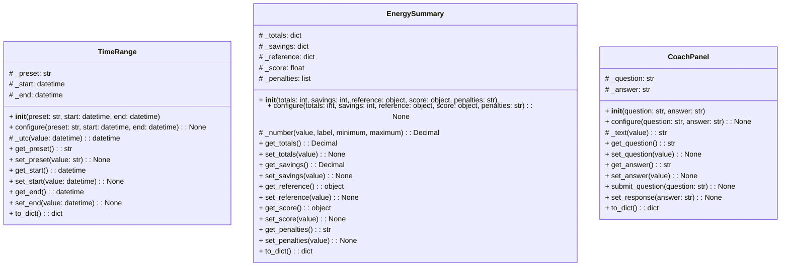
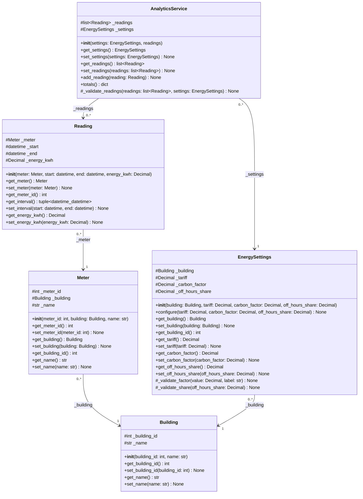
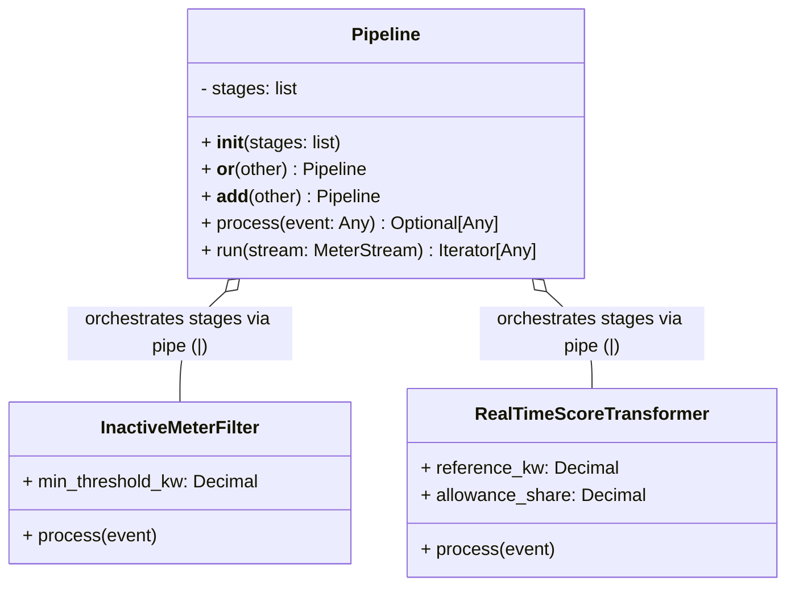
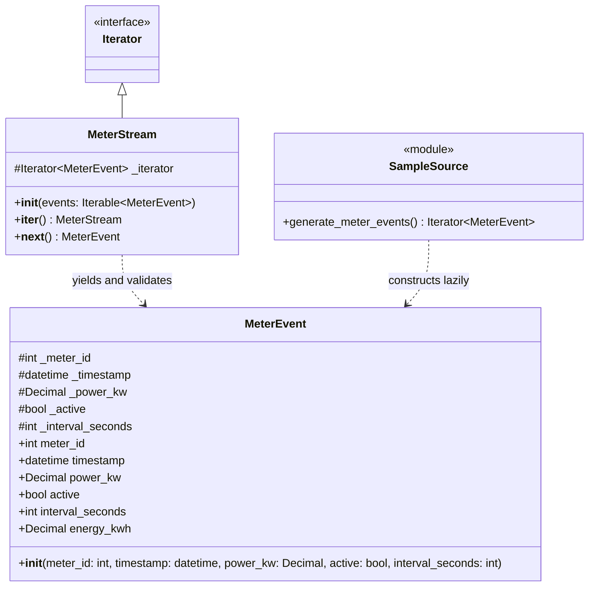
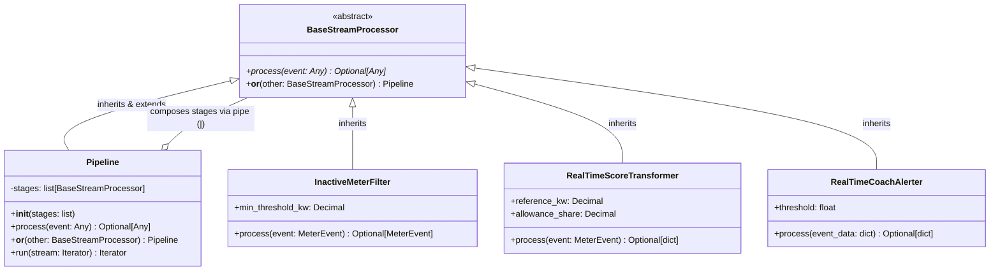

# AI-Powered Smart Energy Management System

Group 18's capstone monitors electricity use in demo office buildings, calculates consumption, cost, and carbon footprints, and provides sustainability scoring, web dashboard interfaces, and AI advice.

## Team Overview

| Member | Subsystem | Package | Responsibility |
| --- | --- | --- | --- |
| Saeid Rafiei Taghanaki | A | `smart_energy/web` | Web dashboard, Flask routes, domain logic, service integration, and web tests |
| Danial Rafiee | B | `smart_energy/analytics` | Data models, MySQL, reading validation, and energy/cost/carbon calculations |
| Hananeh Hajari | C | `smart_energy/coach` | Score and penalties, AI context, OpenAI integration, and AI/scoring tests |

## Project Structure

```text
Capstone-Project/
├── docs/
│   ├── uml/
│   │   ├── analytics_classes.dot
│   │   ├── analytics_classes.mmd
│   │   ├── analytics_classes.png
│   │   ├── analytics_classes.svg
│   │   ├── generate_analytics_uml.py
│   │   ├── generate_b_mermaid.py
│   │   ├── ha2_source.dot
│   │   ├── ha2_source.mmd
│   │   ├── ha2_source.png
│   │   └── ha2_source.svg
│   └── ha2_source.md
├── smart_energy/
│   ├── analytics/
│   │   ├── __init__.py
│   │   ├── analytics_service.py
│   │   ├── building.py
│   │   ├── energy_settings.py
│   │   ├── meter.py
│   │   └── reading.py
│   ├── coach/
│   │   ├── __init__.py
│   │   ├── building_context.py
│   │   ├── coach_service.py
│   │   ├── realtime_coach.py
│   │   ├── score_calculator.py
│   │   └── stream_pipeline.py
│   ├── streaming/
│   │   ├── source/
│   │   │   ├── __init__.py
│   │   │   ├── meter_event.py
│   │   │   ├── meter_stream.py
│   │   │   └── sample_source.py
│   │   ├── __init__.py
│   │   └── pipeline.py
│   ├── web/
│   │   ├── domain/
│   │   │   ├── __init__.py
│   │   │   ├── coach_panel.py
│   │   │   ├── energy_summary.py
│   │   │   └── time_range.py
│   │   ├── templates/
│   │   │   └── dashboard.html
│   │   ├── __init__.py
│   │   ├── app.py
│   │   └── demo_data.py
│   └── __init__.py
├── .gitignore
├── README.md
├── demo.py
├── demo_coach.py
├── demo_ha2.py
├── demo_ha2_coach.py
├── demo_ha2_pipeline..py
├── requirements-web.txt
└── run_web.py
```

`Capstone-Project` is the shared repository name and the local project folder
name. The HA1 submission branch remains `Homeworkassignment001`.

This tree lists the versioned project files in `Homeworkassignment002`. Local virtual environments and IDE settings are omitted. B diagrams use Mermaid; DOT/PNG/SVG files are retained as supplementary exports. A/C documentation is maintained by their respective authors.

## Run the current example

1. Run Console Demo
To test the core OOP and data structures without external dependencies:

```bash
# On Windows:
python demo.py

# On macOS / Linux:
python3 demo.py
```
In PyCharm, right-click `demo.py` in the project tree and choose **Run 'demo'**.
Use that file rather than the earlier step-specific run configurations.

Expected output:

```text
Meter ID: 101
Meter name: Main Meter
Connected building ID: 1
Connected building name: Demo Office
Updated meter name: First Floor Meter
Invalid connection rejected: Meter must be connected to a Building object.
Building after rejected update: Demo Office

Energy reading
Reading meter ID: 101
Start: 2026-11-04T09:00:00+00:00
End: 2026-11-04T09:05:00+00:00
Energy: 2.5 kWh
Updated energy: 3.0 kWh
Invalid energy rejected: Reading energy must be finite and non-negative.
Energy after rejected update: 3.0 kWh

Energy settings
Settings building ID: 1
Tariff: 0.30 EUR/kWh
Carbon factor: 0.40 kg CO2/kWh
Off-hours allowance share: 0.10
Invalid settings rejected: Carbon factor must be finite and non-negative.
Tariff after rejected configuration: 0.30 EUR/kWh

Energy analytics
Reading count: 2
Total energy: 5.0 kWh
Estimated cost: 1.50 EUR
Estimated CO2: 2.00 kg
Duplicate reading rejected: Duplicate or overlapping intervals for the same meter.
Reading count after rejection: 2
```
2. Run Web Dashboard
To start the Flask-based web application interface:
```bash
# First, activate your virtual environment (.venv), then run:
python run_web.py
# (Or use python3 run_web.py on macOS/Linux)
```
Open your browser and navigate to http://127.0.0.1:5000.


## System Design


### Subsystem A class diagram



The diagram shows the core implemented domain and mock data classes for Subsystem A (`smart_energy.web`).

- `+` marks public methods, including `__init__`.
- `#` marks underscore-prefixed attributes, following Python's non-public convention.

### Implemented classes for Subsystem A

Current implemented classes and components in `smart_energy.web`:

| Component / Class | Meaning in the current code |
| --- | --- |
| `TimeRange` | Encapsulates datetime intervals and preset ranges for filtering energy dashboard queries. |
| `EnergySummary` | Acts as a DTO aggregating consumption totals, costs, carbon footprints, and scores. |
| `CoachPanel` | Structures AI coaching prompts, answers, and sustainability advice for the UI. |
| `DemoData` | Generates mock datasets and initial office building topologies for preview. |
| `Flask App & Dashboard` | Configures application routes (`app.py`) and renders summary cards and panels via Jinja2 templates (`dashboard.html`). |


### Subsystem B class diagram



The diagram is generated from the B implementation in this branch. `+` denotes public members and `#` Python non-public convention. Arrows show stored references; multiplicities describe those references.

[Mermaid source](docs/uml/analytics_classes.mmd). Regenerate with `python docs/uml/generate_b_mermaid.py`; GitHub renders the embedded Mermaid blocks directly.

### Implemented classes

Current implemented classes in `smart_energy.analytics`:

- `Building(building_id, name)` stores building identity and name.
- `Meter(meter_id, building, name)` stores meter identity, name and building.
- `Reading(meter, start, end, energy_kwh)` stores interval energy for a meter.
- `EnergySettings(building, tariff, carbon_factor, off_hours_share)` stores
  factors for one building and provides `configure()` for initial setup or
  later reconfiguration.
- `AnalyticsService(settings, readings=None)` holds readings in memory,
  validates their relationships and returns energy, cost and CO2 totals.

All five classes use `__init__` and explicit getters/setters. Constructors use
validated setters or `configure()` so creation and updates follow the same
validation rules. Invalid updates
leave the previous value intact. Leading underscores mark non-public attributes
by Python convention; they do not prevent direct access.

Each meter references one `Building` object. Several meters may reference the
same building. A building ID is read from that object rather than copied into
a second field that could get out of sync. Database persistence and database-wide
identity constraints are not implemented. `AnalyticsService` checks meter ID
consistency within its current collection of readings.

Each reading references one `Meter`, which references one `Building`. The
reading uses `Decimal` for energy in kWh (interval consumption, not instantaneous
power). Energy must be finite and non-negative. The start and end timestamps
must include a timezone and the end must be later than the start. The class
normalizes timestamps to UTC and updates the interval atomically. Duplicate and
overlap checks across multiple readings belong to `AnalyticsService`.
The demonstration uses fixed illustrative timestamps and energy values.

`EnergySettings` stores the tariff in EUR/kWh, the carbon factor in kg CO2/kWh
and the off-hours allowance as a fraction between 0 and 1. These are explicit
demo assumptions. B stores the allowance; C will interpret it in scoring.
`configure()` validates all factors before changing any of them. The example
rejects a configuration containing a negative carbon factor and keeps the
previous tariff unchanged. Cost, carbon and score calculations are not
implemented by this settings class.

`AnalyticsService` totals only the readings explicitly supplied to it. It
requires the same building object as the settings, distinct IDs for distinct
meter objects, and non-overlapping intervals for each meter. Adjacent intervals
are valid, and simultaneous intervals from different meters are valid. An
invalid list, settings change or new reading is rejected before replacing the
stored state. Totals revalidate current objects to catch later meter/interval
changes. The readings getter returns a copy of the list.

An empty collection raises an unavailable-data error rather than reporting a
measured zero. A valid zero-energy reading can produce zero totals. The current
service does not establish complete period coverage, query MySQL, calculate
reference/off-hours metrics, or compute the sustainability score. These remain
later capstone work; scoring belongs to subsystem C.

The demo calculates 3.0 + 2.0 = 5.0 kWh, 5.0 x 0.30 = EUR 1.50 and
5.0 x 0.40 = 2.00 kg CO2. Figures are illustrative and use constant factors.

## HA1 progress

Local branch: `Homeworkassignment001`.

The complete group submission is still in progress. Five B classes are currently
implemented at the OOP demonstration level, with a matching rendered B UML
diagram embedded above. Teammates' classes, their UML, group integration and
the group video remain to be completed. Building operating hours,
essential equipment and full period analytics remain further capstone work.
MySQL, Flask and OpenAI are planned project capabilities
and are not connected in the current example.

## HA1 Presentation Link

The group video has not been recorded yet.
# =====HA2=====
## HA2 — Saeid: Pipeline & Stream Processing Integration

Branch: `Homeworkassignment002`. Saeid's contribution implements the core stream processing **`Pipeline`** mechanism, supporting operator overloading (`|` and `+`) to chain multiple processors (such as filters and transformers) and execute real-time stream transformations sequentially.

### Subsystem A Pipeline Architecture (Mermaid Class Diagram)

### HA2 Implementation Highlights

- **Pipeline Orchestration (`pipeline.py`):** Chains multiple processing stages sequentially and drops events early if any stage returns `None`.
- **Operator Overloading:** Implements `__or__` and `__add__` to allow natural pipeline composition using `filter_stage | transform_stage`.
- **Stream Execution:** Iterates through `MeterStream` events and yields processed results via `run()`.

### Subsystem A Pipeline Demo

To execute the integration stream processing demonstration:
```bash
python3 demo_ha2_pipeline.py
```

## HA2 — Danial: stream source

Branch: `Homeworkassignment002`. Danial's input contribution provides validated
`MeterEvent` objects, a single-pass `MeterStream` implementing `__iter__` and
`__next__`, and a lazy sample generator using `yield`.



[Mermaid source](docs/uml/ha2_source.mmd)

See [the event contract and source documentation](docs/ha2_source.md).
Run `python3 demo_ha2.py` from the repository root.

The remaining group implementation must add the explicit abstract processor
contract, specialized filter/transform processors, operator-based pipeline
composition and the five-minute presentation link. The original HA1 sections
above describe the earlier implementation; this section documents only the
current HA2 source contribution.


## HA2 — Hananeh: Real-Time Stream Pipeline & AI Coach

Branch: `Homeworkassignment002`. Subsystem C's contribution processes real-time event streams from IoT meters, evaluates operational penalties on the fly, computes live sustainability scores, and triggers instant AI coach intervention alerts.

### Subsystem C Stream Architecture (Mermaid Class Diagram)



### HA2 Implementation Highlights
- **Abstract Base Classes (ABCs):** `BaseStreamProcessor` enforces the `@abstractmethod` contract for `process()`.
- **Inheritance & Polymorphism:** `InactiveMeterFilter`, `RealTimeScoreTransformer`, and `RealTimeCoachAlerter` adhere to a uniform streaming contract.
- **Operator Overloading:** Overloaded `__or__` allows natural pipeline chaining:
```python
pipeline = filter_stage | transform_stage | alert_stage
```
- **Stream Consumption:** Evaluates stream events yielded by `MeterStream` iterator on the fly.

### Running Subsystem C Demo
Run the standalone real-time streaming demonstration:
```bash
python3 demo_ha2_coach.py
```

### HA2 Presentation Link
The 5-minute video walkthrough link will be placed here:
- **Presentation Video:** `[Pending Recording / Video Link]`