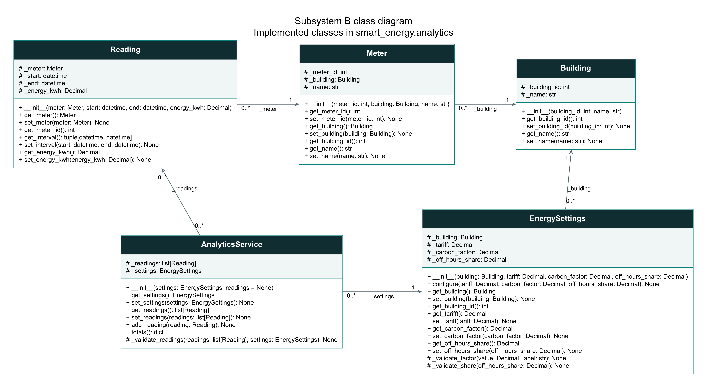
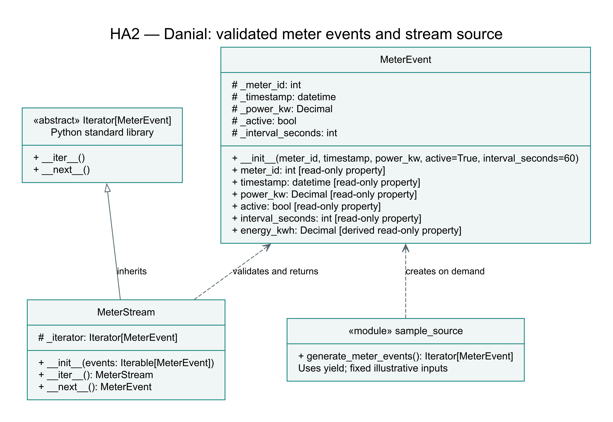
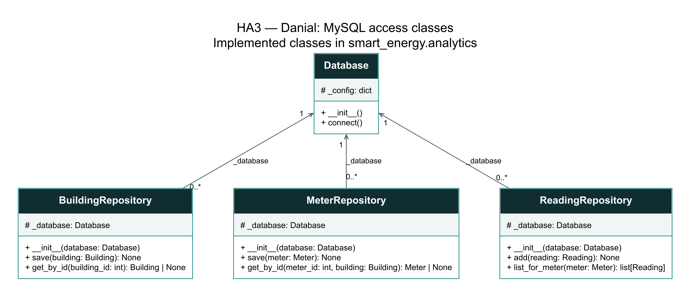
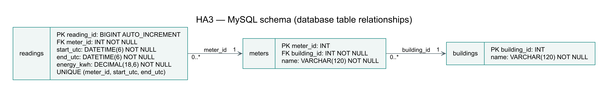

# AI-Powered Smart Energy Management System

Group 18's capstone monitors electricity use in one demo office building,
calculates consumption, cost and carbon, and provides sustainability scoring
and AI advice. The current implementation is the initial OOP learning stage.

## Team Overview

| Member | Subsystem | Package | Responsibility |
| --- | --- | --- | --- |
| Saeid Rafiei Taghanaki | A | `smart_energy/web` | Dashboard, Flask routes, service integration and web tests |
| Danial Rafiee | B | `smart_energy/analytics` | Data models, MySQL, reading validation and energy/cost/carbon calculations |
| Hananeh Hajari | C | `smart_energy/coach` | Score and penalties, AI context, OpenAI integration and AI/scoring tests |

## Project structure

```text
Capstone-Project/
├── README.md
├── .gitignore
├── demo.py
├── docs/
│   └── uml/
│       ├── analytics_classes.dot
│       ├── analytics_classes.svg
│       ├── analytics_classes.png
│       └── generate_analytics_uml.py
└── smart_energy/
    ├── __init__.py
    ├── web/
    │   └── __init__.py
    ├── analytics/
    │   ├── __init__.py
    │   ├── building.py
    │   ├── meter.py
    │   ├── reading.py
    │   ├── energy_settings.py
    │   └── analytics_service.py
    └── coach/
        └── __init__.py
```

`Capstone-Project` is the shared repository name and the local project folder
name. The HA1 submission branch remains `Homeassignment1`.

`web` and `coach` contain package placeholders for teammates' work. The
`docs/uml` directory contains the B class diagram source, its rendered SVG/PNG
images and the generator that reads method signatures from the implementation.

## Run the current example

Use Python 3. No external packages are required for the current example.

From this folder, run:

```bash
python3 demo.py
```

In PyCharm, right-click `demo.py` in the project tree and choose **Run 'demo'**.
Use that file rather than the earlier step-specific run configurations.

Expected output:

```text
Meter ID: 101
Meter name: Main Meter
Connected building ID: 1
Connected building name: Demo Office
Updated meter name: First Floor Meter
Invalid connection rejected: Meter must be connected to a Building object.
Building after rejected update: Demo Office

Energy reading
Reading meter ID: 101
Start: 2026-11-04T09:00:00+00:00
End: 2026-11-04T09:05:00+00:00
Energy: 2.5 kWh
Updated energy: 3.0 kWh
Invalid energy rejected: Reading energy must be finite and non-negative.
Energy after rejected update: 3.0 kWh

Energy settings
Settings building ID: 1
Tariff: 0.30 EUR/kWh
Carbon factor: 0.40 kg CO2/kWh
Off-hours allowance share: 0.10
Invalid settings rejected: Carbon factor must be finite and non-negative.
Tariff after rejected configuration: 0.30 EUR/kWh

Energy analytics
Reading count: 2
Total energy: 5.0 kWh
Estimated cost: 1.50 EUR
Estimated CO2: 2.00 kg
Duplicate reading rejected: Duplicate or overlapping intervals for the same meter.
Reading count after rejection: 2
```

## System Design

### Subsystem B class diagram



[Open the scalable diagram](docs/uml/analytics_classes.svg) ·
[Diagram source](docs/uml/analytics_classes.dot)

The diagram shows the five currently implemented B classes, their attributes,
constructor signatures, getters/setters, configuration and calculation methods.
It does not include unimplemented database, web or AI classes.

- `+` marks public methods, including `__init__`.
- `#` marks underscore-prefixed attributes/helpers, following Python's
  non-public convention; it does not imply enforced access protection.
- Solid arrows show navigable associations, not inheritance or composition.
- `1` means exactly one related object; `0..*` means zero or more.

| Relationship | Meaning in the current code |
| --- | --- |
| `Meter` to `Building` | Each meter references one building. Multiple meters may reference the same building. |
| `Reading` to `Meter` | Each reading references one meter. A meter may have multiple readings. |
| `EnergySettings` to `Building` | Each configuration references one building. The classes do not enforce a unique configuration per building; the demo uses one. |
| `AnalyticsService` to `EnergySettings` | Each service references one configuration. A configuration may be shared by services. |
| `AnalyticsService` to `Reading` | A service holds zero or more reading references. A reading may be used by multiple services. |

The diagram generator checks the attribute names and reads all method
signatures directly from the five Python classes. To update the source:

```bash
python3 docs/uml/generate_analytics_uml.py
```

To regenerate the images with a separately installed Graphviz renderer:

```bash
dot -Tsvg docs/uml/analytics_classes.dot -o docs/uml/analytics_classes.svg
dot -Tpng docs/uml/analytics_classes.dot -o docs/uml/analytics_classes.png
```

Graphviz is only needed to regenerate the diagram images. Running `demo.py`
requires no external packages.

### Implemented classes

Current implemented classes in `smart_energy.analytics`:

- `Building(building_id, name)` stores building identity and name.
- `Meter(meter_id, building, name)` stores meter identity, name and building.
- `Reading(meter, start, end, energy_kwh)` stores interval energy for a meter.
- `EnergySettings(building, tariff, carbon_factor, off_hours_share)` stores
  factors for one building and provides `configure()` for initial setup or
  later reconfiguration.
- `AnalyticsService(settings, readings=None)` holds readings in memory,
  validates their relationships and returns energy, cost and CO2 totals.

All five classes use `__init__` and explicit getters/setters. Constructors use
validated setters or `configure()` so creation and updates follow the same
validation rules. Invalid updates
leave the previous value intact. Leading underscores mark non-public attributes
by Python convention; they do not prevent direct access.

Each meter references one `Building` object. Several meters may reference the
same building. A building ID is read from that object rather than copied into
a second field that could get out of sync. Database persistence and database-wide
identity constraints are not implemented. `AnalyticsService` checks meter ID
consistency within its current collection of readings.

Each reading references one `Meter`, which references one `Building`. The
reading uses `Decimal` for energy in kWh (interval consumption, not instantaneous
power). Energy must be finite and non-negative. The start and end timestamps
must include a timezone and the end must be later than the start. The class
normalizes timestamps to UTC and updates the interval atomically. Duplicate and
overlap checks across multiple readings belong to `AnalyticsService`.
The demonstration uses fixed illustrative timestamps and energy values.

`EnergySettings` stores the tariff in EUR/kWh, the carbon factor in kg CO2/kWh
and the off-hours allowance as a fraction between 0 and 1. These are explicit
demo assumptions. B stores the allowance; C will interpret it in scoring.
`configure()` validates all factors before changing any of them. The example
rejects a configuration containing a negative carbon factor and keeps the
previous tariff unchanged. Cost, carbon and score calculations are not
implemented by this settings class.

`AnalyticsService` totals only the readings explicitly supplied to it. It
requires the same building object as the settings, distinct IDs for distinct
meter objects, and non-overlapping intervals for each meter. Adjacent intervals
are valid, and simultaneous intervals from different meters are valid. An
invalid list, settings change or new reading is rejected before replacing the
stored state. Totals revalidate current objects to catch later meter/interval
changes. The readings getter returns a copy of the list.

An empty collection raises an unavailable-data error rather than reporting a
measured zero. A valid zero-energy reading can produce zero totals. The current
service does not establish complete period coverage, query MySQL, calculate
reference/off-hours metrics, or compute the sustainability score. These remain
later capstone work; scoring belongs to subsystem C.

The demo calculates 3.0 + 2.0 = 5.0 kWh, 5.0 x 0.30 = EUR 1.50 and
5.0 x 0.40 = 2.00 kg CO2. Figures are illustrative and use constant factors.

## HA1 progress

Local branch: `Homeassignment1`.

The complete group submission is still in progress. Five B classes are currently
implemented at the OOP demonstration level, with a matching rendered B UML
diagram embedded above. Teammates' classes, their UML, group integration and
the group video remain to be completed. Building operating hours,
essential equipment and full period analytics remain further capstone work.
MySQL, Flask and OpenAI are planned project capabilities
and are not connected in the current example.

## Presentation Link

The group video has not been recorded yet.


## HA2 — Danial: stream source

Branch: `HomeworkAssignment2`. Danial's input contribution provides validated
`MeterEvent` objects, a single-pass `MeterStream` implementing `__iter__` and
`__next__`, and a lazy sample generator using `yield`.



See [the event contract and source documentation](docs/ha2_source.md).
Run `python3 demo_ha2.py` from the repository root.

The remaining group implementation must add the explicit abstract processor
contract, specialized filter/transform processors, operator-based pipeline
composition and the five-minute presentation link. The original HA1 sections
above describe the earlier implementation; this section documents only the
current HA2 source contribution.


## HA3 — Danial: MySQL data access

Branch: `Homeworkassignment003`. Danial's B contribution adds Database,
BuildingRepository, MeterRepository and ReadingRepository. The shared domain
classes and AnalyticsService read real stored readings through these repositories.





See [setup, storage behavior and the integration contract](docs/ha3_database.md).
Install `requirements-ha3.txt`, create the schema with `sql/schema_ha3.sql`,
configure local database credentials through environment variables if needed,
and run `python demo_ha3.py` from the repository root.

The two retrieved demo readings total 5.0 kWh, EUR 1.50 and 2.00 kg CO2 with
explicit sample factors. This section documents B only. Subsystem A must connect
the repositories to the final Flask/Django response. The group's final README,
complete diagrams and five-minute video link remain to be integrated.
