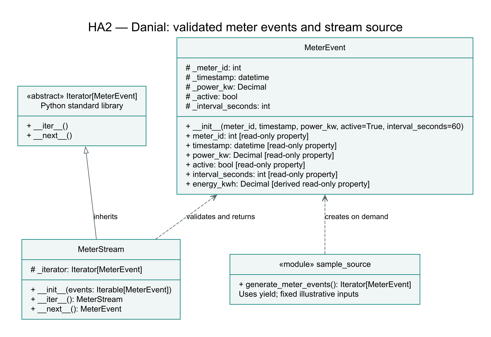

# HA2 — Danial — Event and stream source

Danial implements the input side of the shared stream-processing project:
`MeterEvent`, `MeterStream` and the `generate_meter_events()` generator function.
The generator function is not an additional class. HA2 does not repeat HA1's
three-classes-per-member requirement in the supplied assignment text.

## Class diagram



[Scalable SVG](uml/ha2_source.svg) · [Diagram source](uml/ha2_source.dot)

A solid hollow-triangle arrow is inheritance. Dashed arrows show use, not
ownership. The generator module is explicitly labelled as a module, not a class.
Underscores denote Python's non-public convention, not enforced privacy.

## Event contract for teammates

Import from `smart_energy.streaming.source.meter_event` and
`smart_energy.streaming.source.meter_stream`. The sample generator is imported
from `smart_energy.streaming.source.sample_source`.

| Property | Meaning and validation |
| --- | --- |
| `meter_id` | Positive integer; bool is rejected |
| `timestamp` | End of measurement interval; timezone-aware datetime, normalized to UTC |
| `power_kw` | Average non-negative consumption power for the interval; finite Decimal |
| `active` | Strict bool; inactive events remain available to the filter stage |
| `interval_seconds` | Positive integer interval length; bool is rejected |
| `energy_kwh` | Derived Decimal: power_kw × interval_seconds / 3600 |

The public properties are read-only. Create a new event for a new reading.
The current event represents non-negative consumption, not signed solar/battery
net flow. A future bidirectional schema requires an explicit extension.

## Iterator and generator

`MeterStream` inherits Python's `Iterator[MeterEvent]` and explicitly implements
`__iter__` and `__next__`. It wraps an iterable without converting it into a list.
Each call requests one event and rejects items that are not MeterEvent objects.
It is single-pass: reaching the end raises StopIteration and does not reset it.

`generate_meter_events()` uses `yield`. Its fixed raw sample values are stored
in a small tuple, but MeterEvent objects are constructed only when requested.
It is a simulated finite source, not a live device connection or a measured
high-frequency throughput implementation.

The input layer deliberately keeps inactive and low-power events. Filtering
those events, metric transformation, the explicit `@abstractmethod` processor
contract and operator-based pipeline composition belong to the remaining group
implementation. This source contribution alone is not the complete HA2.

## Run this contribution

From the repository root, with Python 3.10 or later:

```bash
python3 demo_ha2.py
```

No external packages or credentials are needed. The demo first validates one
6.0 kW, 60-second event (0.1 kWh), rejects negative power, then consumes the sample
generator through MeterStream. It yields meters 101, 102 and 103 in order, with
powers 6.0, 0.2 and 4.0 kW and active flags True, True and False.

Verified behaviors: lazy construction, ordered iteration, single-pass exhaustion,
empty streams and rejection of invalid stream item types.

## Submission

Use the exact shared branch `Homeworkassignment002`. Each member uploads their
own files. The shared README must eventually contain diagrams of the full
implemented framework and a direct link to the team's five-minute video.
This contribution does not include or claim that video or the other processors.
