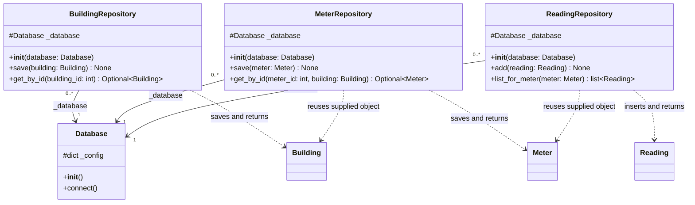
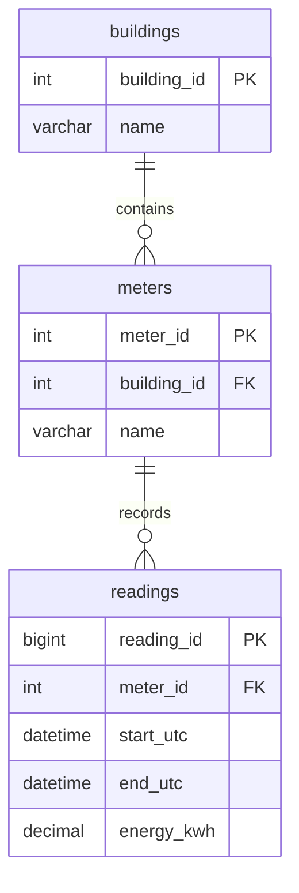

# HA3 — Danial — MySQL data access

Branch: `Homeworkassignment003`. This is subsystem B's contribution, not the
complete Flask/MySQL group submission. The web route and final HTTP display
remain to be connected by subsystem A.

## Implemented classes and diagrams

- `Database`: reads process environment settings and opens MySQL connections.
- `BuildingRepository`: saves/upserts buildings and retrieves them by ID.
- `MeterRepository`: saves/upserts a meter's name/building and retrieves it for
  a supplied Building object.
- `ReadingRepository`: inserts interval energy, rejects duplicates/overlaps
  through the repository, and retrieves readings for a supplied Meter object.



[Mermaid source](uml/ha3_repositories.mmd)

These four classes use the existing five domain/analytics classes from HA1:
Building, Meter, Reading, EnergySettings and AnalyticsService.
See [the domain Mermaid UML](uml/analytics_classes.mmd).
The repository diagram's solid arrows are stored Database references;
Database is a connection factory, not an always-open connection.



[Mermaid ER source](uml/ha3_schema.mmd)

The table diagram is a database relationship diagram, separate from the class UML.
The database has three tables: buildings, meters and readings. Each meter
references one building and each reading one meter. Foreign keys reject missing
parents. The schema's unique constraint rejects exact duplicate intervals.
Cross-interval overlap checks are performed in ReadingRepository.

## Set up a fresh environment

1. Install/start MySQL 8.4. For the author's Apple Silicon Mac:

```bash
brew install mysql@8.4
brew services start mysql@8.4
```

2. Use Python 3.10 or later and install B's dependency in the active environment:

```bash
python -m pip install -r requirements-ha3.txt
```

The author's tested environment is Python 3.14.4, Connector/Python 9.7.0 and
MySQL 8.4. The connector supports Python 3.14 starting with version 9.5.

3. Create the schema from the repository root. With a MySQL client on PATH:

```bash
mysql -u root -p < sql/schema_ha3.sql
```

The client prompts for the local MySQL password. A fresh Homebrew install may
have an empty local root password; press Enter only if that is your setup.
On the author's Mac, the client executable is
`/opt/homebrew/opt/mysql@8.4/bin/mysql` if `mysql` is not on PATH.
The script creates `smart_energy_ha3` and missing tables; it does not delete
existing data or migrate a differently defined existing table.

4. Configure credentials for your local MySQL installation if different from
these development defaults:

| Environment variable | Default |
| --- | --- |
| SMART_ENERGY_DB_HOST | 127.0.0.1 |
| SMART_ENERGY_DB_PORT | 3306 |
| SMART_ENERGY_DB_USER | root |
| SMART_ENERGY_DB_PASSWORD | root |
| SMART_ENERGY_DB_NAME | smart_energy_ha3 |

Database reads environment variables when constructed. Set them in your shell
or PyCharm run configuration. A `.env` file is **not loaded automatically**.
No real password is included in the repository. The root default is for the
current local learning setup; a configured application user can be used instead.
If using another database name, update the schema script's CREATE/USE statements
as well as the environment setting.

5. Run from the repository root:

```bash
python demo_ha3.py
```

## What the demonstration proves

The script saves/loads building 1 (Demo Office) and meter 101 (Main Meter), then
inserts two illustrative readings for 4 November 2026, 09:00–09:05 and
09:05–09:10 UTC, with energies 3.0 and 2.0 kWh. On reruns it skips matching
samples; it raises an error if a stored sample has a different energy rather
than overwriting it. Building/meter save methods do update their demo ID's name
and parent link as documented, so use this dedicated sample database.

The script retrieves the two sample readings from MySQL and supplies them to
AnalyticsService with illustrative factors. It calculates:

```text
Demo reading count: 2
Total energy: 5.0 kWh
Estimated cost: 1.50 EUR
Estimated CO2: 2.00 kg
Duplicate rejected: Duplicate or overlapping interval for this meter.
```

The consumption is retrieved from MySQL, not a fixed displayed total. Tariff
0.30 EUR/kWh, carbon factor 0.40 kg/kWh and off-hours share 0.10 are explicit
sample configuration, not live rates or database-stored settings. The demo
aggregates only its two sample intervals, not the meter's complete history.

## Storage behavior

- Parameter values are passed separately from SQL using connector parameters.
- Connections/cursors are closed after use; successful writes are committed.
- A failed reading insertion rolls back its transaction and re-raises the error.
- Reading insertion locks the parent meter row before the overlap check, so
  inserts using this repository for the same meter are serialized. Direct SQL
  writers bypass the application's overlap policy.
- Adjacent half-open intervals are allowed; duplicates and overlaps are rejected.
- DATETIME(6) stores UTC timestamps without timezone metadata. ReadingRepository
  converts aware input to UTC and attaches UTC when rebuilding Reading objects.
- DECIMAL(18,6) stores up to 12 integer and 6 fractional digits. The repository
  rejects excessive energy/richer fractional precision instead of rounding it.
- This implementation does not determine complete measurement coverage.

## Integration contract for Saeid

Use these imports from `smart_energy.analytics` modules:

```python
from smart_energy.analytics.database import Database
from smart_energy.analytics.building_repository import BuildingRepository
from smart_energy.analytics.meter_repository import MeterRepository
from smart_energy.analytics.reading_repository import ReadingRepository
from smart_energy.analytics.energy_settings import EnergySettings
from smart_energy.analytics.analytics_service import AnalyticsService
```

1. Create Database and the three repositories.
2. Retrieve the building with `get_by_id(building_id)`; None means not found.
3. Retrieve its meter with `get_by_id(meter_id, building)`; None means no matching
   meter/building association.
4. Call `list_for_meter(meter)` to retrieve ordered Reading objects.
5. Construct EnergySettings using that **same building object** and agreed
   Decimal factors, then call `AnalyticsService(settings, readings).totals()`.
6. Handle no readings separately: In the HA3 version AnalyticsService raises ValueError rather
   than reporting an invented measured zero. In this HA4 branch that case raises
   AnalyticsError with code `no_readings`. Decide appropriate HTTP responses
   in the web layer. Convert Decimal output explicitly (e.g. decimal strings)
   when defining the JSON contract, and label units/currency clearly.

Meter retrieval reuses the supplied Building object. Reading retrieval reuses
the supplied Meter object. This preserves the object relationships required
by the original AnalyticsService. The repositories do not create Flask routes.

The group still needs an actual Flask/Django-to-MySQL response, diagrams matching
all final code, current shared run instructions and the five-minute video link
before the whole HA3 submission is complete.

## Diagram regeneration

Run `python docs/uml/generate_b_mermaid.py` to rebuild the B class diagrams from the current Python source. Their Mermaid blocks are embedded in this document and the README for direct rendering on GitHub. The ER diagram describes table relationships separately. Existing DOT/PNG/SVG files are supplementary exports.

## References

- [Official MySQL Connector/Python guide](https://dev.mysql.com/doc/connector-python/en/)
- [Connector/Python compatibility](https://dev.mysql.com/doc/connector-python/en/connector-python-versions.html)
- [Official Flask quickstart](https://flask.palletsprojects.com/en/stable/quickstart/)
- [Homebrew MySQL 8.4](https://formulae.brew.sh/formula/mysql@8.4)
