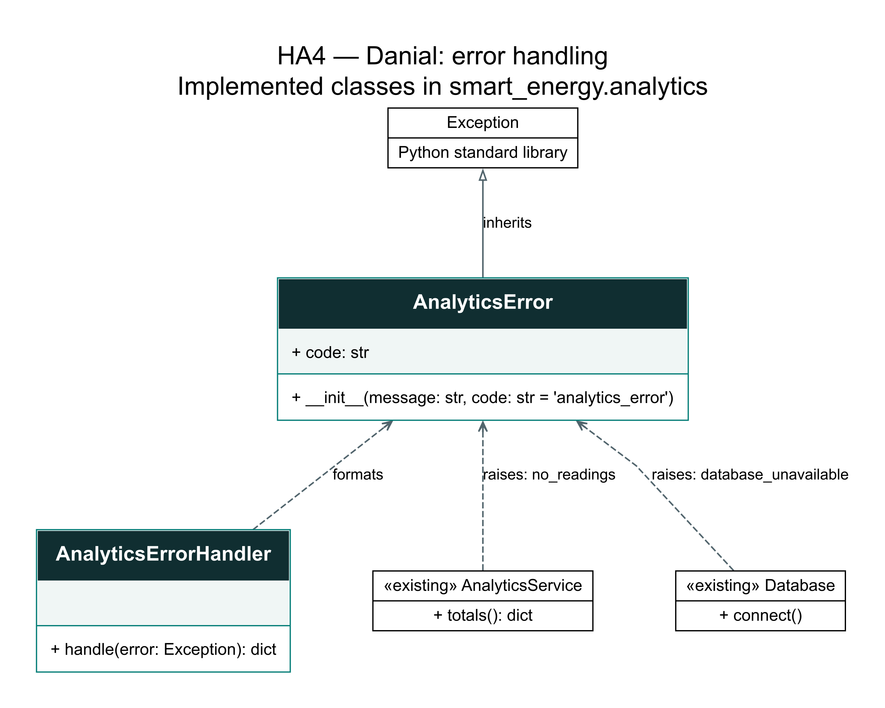

# HA4 — Danial — Error handling and five unit tests

Branch: `Homeworkassignment004`. This documents subsystem B's contribution.
The group still needs error-handling classes for A and C and at least 15
different tests across the application. A proposed split of five tests per
member is a team coordination choice, not an instructor-imposed allocation.

## Implemented error handling

`smart_energy/analytics/errors.py` contains:

- `AnalyticsError(Exception)`: a custom application exception with a `code`.
- `AnalyticsErrorHandler.handle(error)`: converts an exception to an error
  dictionary with consistent `code` and `message` fields.



[Scalable diagram](uml/ha4_errors.svg) · [Source](uml/ha4_errors.dot)

The new classes are shown with their current fields/methods. Existing Database
and AnalyticsService are abbreviated to the operations involved in this change.
A hollow triangle shows inheritance; dashed arrows show dependencies/raising,
not stored ownership.

These classes are used by actual application methods:

- `AnalyticsService.totals()` raises AnalyticsError with code `no_readings`
  when no measurements are supplied. This replaces the HA3 version's ValueError
  for that specific case. A valid measured zero remains a measured zero.
- `Database.connect()` translates MySQL connection exceptions to AnalyticsError
  with code `database_unavailable`, using `raise ... from error` to preserve
  the original exception for diagnosis.
- Validation exceptions from the existing models/services are formatted as
  `validation_error` by the handler at the caller's error boundary.

| Input error | Output code | Response behavior |
| --- | --- | --- |
| AnalyticsError | Its explicit code | Its application message |
| MySQL connector error | database_error | Generic database-operation message |
| ValueError / TypeError | validation_error | Generic data/operation validation message |
| Other exception | unexpected_error | Generic subsystem failure message |

An unavailable connection uses the more specific `database_unavailable` code
because Database.connect already translates it to AnalyticsError. The handler
does not send the raw connector exception text to the client.

## Run

Use Python 3.10 or later in this project's virtual environment:

```bash
python -m pip install -r requirements-ha4.txt
python demo_ha4.py
python -m pytest tests/test_analytics_ha4.py -v
```

Verified environment: Python 3.14.4, MySQL Connector/Python 9.7.0 and pytest 9.2.0.
The demo and these unit tests do not connect to MySQL or change stored data.
The connection failure is injected with a mock; the MySQL server is not stopped.
These unit tests do not replace the separate real-MySQL check in HA3.

## Five distinct tests

| Test | Behavior checked |
| --- | --- |
| test_valid_readings_produce_correct_energy_cost_and_carbon | Known energy/cost/carbon totals, counts and building identity |
| test_no_readings_raise_a_specific_application_error | Actual service raises `no_readings`, and the handler formats it |
| test_negative_energy_is_rejected_and_formatted_as_validation_error | Actual Reading validation rejects negative energy; response is consistent |
| test_overlap_is_rejected_without_changing_existing_results | A partially overlapping interval is rejected; original readings/totals remain intact |
| test_connection_failure_preserves_cause_and_hides_internal_details | Actual Database.connect translates the injected driver failure, preserves its cause and returns no internal detail in the response |

Each test receives fresh domain objects. The expected result is **5 passed**.
There is no real-database fixture and no deletion or cleanup of project data.
The suite checks these five behaviors; it does not claim full branch coverage
of every model, repository, error mapping or web endpoint.

## Contract for Saeid's Flask integration

Import the classes from `smart_energy.analytics.errors`:

```python
from smart_energy.analytics.errors import AnalyticsError, AnalyticsErrorHandler
```

At the B-operation boundary, catch the relevant exception and call
`AnalyticsErrorHandler().handle(error)`. Its result is JSON-compatible:

```json
{
  "error": {
    "code": "no_readings",
    "message": "No readings are available for calculation."
  }
}
```

The handler returns a dictionary, not a Flask Response, and does not assign
HTTP status codes. A must choose and test the agreed HTTP status, serialize the
dictionary, and log original exceptions internally when appropriate. A failed
operation must not be presented as successful zero consumption. Unexpected
programming failures should not automatically be classified as bad user input.

The B test fixture is local to `test_analytics_ha4.py`. A and C can add their own
files under `tests/` without editing this fixture. After integration, run
`python -m pytest tests -v` to check the complete group suite, and confirm that
at least 15 different application tests are collected and pass.

## Remaining group submission work

- Error-handling classes and real usage for A and C.
- At least 15 different tests in total, including the agreed Flask application
  checks. Five B unit tests alone are not the full HA4 submission.
- Final diagrams/run instructions and a direct link to the group's five-minute
  presentation in the shared README.

## References

- [Python errors and exceptions](https://docs.python.org/3/tutorial/errors.html)
- [Flask testing](https://flask.palletsprojects.com/en/stable/testing/)
- [pytest getting started](https://docs.pytest.org/en/stable/getting-started.html)
